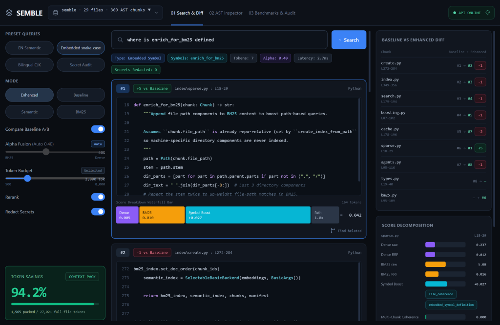

# Semble Code Retrieval & Ranking Lab (`semble-code-lab`)

<p align="center">
  <strong>CPU-First Bilingual Hybrid Code Retrieval Engine, Explainable RRF Ranking Pipeline & Obsidian Workbench</strong><br/>
  <em>基于上游 <code>MinishLab/semble</code> 深度重构的纯 CPU 中英双语混合代码检索引擎、可解释重排序流水线与全栈实验台</em>
</p>

<p align="center">
  
  
  
  
  
  
</p>



---

## Overview / 项目简介

**Semble Code Retrieval & Ranking Lab** upgrades [`MinishLab/semble`](https://github.com/MinishLab/semble) (commit `a1ba6c1`, MIT) from a pure ASCII/CLI search utility into an **explainable, security-hardened, bilingual (EN/CN) full-stack Code Retrieval & Ranking Workbench** built for AI coding agents — running **100% on local CPU with zero GPU or paid LLM API dependencies**.

本项目在 `MinishLab/semble` 原版基础上进行了系统性工程化升级与离线基准验证：
- **解决中文零命中短板**：原版纯 ASCII 正则对纯中文技术查询返回空词元（`bm25_hits = 0`）；本仓库构建了零依赖 **CJK 一元/二元分词 + 94 条通用软件工程中→英概念扩展词表 + 自适应词法索引路由**，让纯中文提问也能在**全英文零中文注释开源仓**（`fastapi`）上稳定命中源码；
- **修复嵌入式 `snake_case` 符号加权盲区**：原版仅识别嵌入自然语言的 `CamelCase`，忽略 `snake_case` 与命名空间标识符；修复后通过 Unicode 安全边界精确锁定定义块并输出透明得分拆解；
- **补全可解释性与生产安全护栏**：提供四模式 A/B 同屏对比（`Enhanced` / `Baseline` / `Semantic` / `BM25`）、Token 预算上下文贪心打包、10+ 类敏感凭据确定性脱敏与本地路径穿越防护。

---

## Architecture / 系统架构

```text
┌──────────────────────────────────────────────────────────────────────────────┐
│                 React 19 + TypeScript Obsidian Lab (:5173)                   │
│   [01 Search & Diff]         [02 AST Inspector]      [03 Benchmarks & Audit] │
│   • Preset Queries           • Repo Indexer          • 4-Mode IR Ablation    │
│   • Score Waterfall Bar      • File Penalty Tree     • Masked Security Audit │
│   • Baseline Rank Diff       • Tree-sitter Chunks    • OpenAPI Contract Sync │
└──────────────────────────────────────┬───────────────────────────────────────┘
                                       │ /api/* (Vite Dev Proxy + CORS)
┌──────────────────────────────────────▼───────────────────────────────────────┐
│                     FastAPI Control Plane (:8000 · 9 Routes)                 │
│   semble-core (29 files / 369 AST chunks)   │   bilingual-demo (Py/TS/Go/SQL)│
└──────────────────────────────────────┬───────────────────────────────────────┘
                                       │
┌──────────────────────────────────────▼───────────────────────────────────────┐
│                 Pure-CPU Bilingual Code Retrieval Core                       │
│                                                                              │
│  Query ─► Adaptive Router (needs_bilingual_index)                            │
│             ├── Pure ASCII/Code ────────► Upstream Zero-Noise BM25 Index     │
│             └── CJK / 3-4 Digit Codes ──► Bilingual BM25 + 94 SE CN→EN Terms │
│          + model2vec (minishlab/potion-code-16M-v2) Dense Cosine Index       │
│          ▼                                                                   │
│  Adaptive Alpha Fusion (0.20 CJK / 0.30 Mixed&Symbol / 0.40 Embedded / 0.50) │
│          ▼                                                                   │
│  Code-Aware Reranker: Multi-Chunk Coherence + Symbol Def Boost + Path Decay  │
│          ▼                                                                   │
│  ScoreBreakdown Tracer ─► Token-Budget Greedy Packer ─► Secret Redactor      │
└──────────────────────────────────────────────────────────────────────────────┘
```

---

## Key Upgrades over Upstream / 核心技术升级

1. **Adaptive Bilingual Tokenization & Zero-Regression Lexical Routing** (`src/semble/tokens.py`, `src/semble/search.py`)
   - Keeps upstream ASCII `split_identifier` (`camelCase` / `snake_case`) compatibility untouched while adding CJK unigram/bigram slicing, 3–4 digit HTTP/port code preservation (`[1-9][0-9]{2,3}` without `0..99` numeric bloat), and **94 general software-engineering CN→EN concept mappings** (`expand_cjk_concepts`).
   - `needs_bilingual_index()` routes pure English/ASCII queries (without 3–4 digit codes) directly to the clean upstream ASCII BM25 index so large-scale English code retrieval suffers zero vocabulary/document-length drift.
2. **Embedded `snake_case` & Namespace Symbol Boosting** (`src/semble/ranking/boosting.py`)
   - Replaces Unicode `\b` traps with explicit `(?<![A-Za-z0-9_])` / `(?![A-Za-z0-9_])` boundaries so mixed CN-EN identifiers (`中文cache_key`、`where is enrich_for_bm25 defined`、`RequestRouter.dispatch`、`A::B`) trigger full definition recall.
   - Tightens bare module-level binding regex (`_binding_pattern`) to column-0 anchors, preventing local variables inside functions from causing false definition boosts, alongside adaptive `resolve_alpha` weights (`0.20` CJK / `0.30` Mixed & Bare Symbol / `0.40` Embedded Symbol / `0.50` Natural Language).
3. **Explainable Score Breakdown & A/B Comparison** (`src/semble/search.py`, `src/semble/types.py`)
   - Preserves `SembleIndex.search()` while adding `search_explained()` outputting stage-by-stage attribution (`semantic_raw/rrf`, `bm25_raw/rrf`, `alpha_weight`, `fused_rrf`, `multi_chunk_boost`, `query_boost`, `boost_reasons`, `path_penalty`, `saturation_decay`, `final_score`) plus live `Baseline` rank delta comparison.
4. **Context Budget Packer, Secret Redaction & Windows Portability** (`src/semble/context_packer.py`, `src/semble/security.py`, `src/semble/stats.py`)
   - Deterministic CJK+code token estimator and greedy line-deduplicated context packer measuring exact token savings vs full-file `grep+read`.
   - Zero-dependency credential scanner/redactor (`AWS AKIA`, `Aliyun LTAI`, `GitHub ghp_/github_pat_`, `OpenAI/Anthropic sk-*`, `Slack xox*`, `PEM Private Keys`, `JWT/Bearer`, `PostgreSQL/MySQL/Redis DSN`, `+86` CN mobile numbers) and strict `validate_safe_local_path` traversal/symlink guard.
   - Cross-platform `fcntl` typing guard in `stats.py`, resolving all Windows `mypy` errors (`0` errors across `37` source files).
5. **FastAPI + React/TS Dark Workbench** (`src/semble/server/`, `前端/`)
   - 9 typed REST routes verified by automated OpenAPI contract tests (`后端/docs/openapi.json` ↔ Vitest `contract.test.ts`).

---

## Verified Benchmark Results / 多层离线盲测实测数据

All measurements below were executed live on local Windows CPU (`CPython 3.12.15`, `minishlab/potion-code-16M-v2`, zero LLM calls, strict offline isolation):

### 1. External Public Benchmark — `CoIR-Retrieval/cosqa` (20,604 Functions × 500 Test Queries)

| Mode | `NDCG@10` (Before Routing Fix) | `NDCG@10` (Final) | `MRR@10` | `Recall@5` | `Recall@10` | Mean / P95 Latency |
|---|---:|---:|---:|---:|---:|---:|
| `baseline` (upstream) | `0.2327` | `0.2332` | `0.1805` | `0.2880` | `0.4060` | `13.43 / 16.49 ms` |
| **`enhanced` (ours)** | `0.2257` (`-0.0070`) | **`0.2307`** (`-0.0025`*) | `0.1776` | **`0.2900`** | `0.4040` | **`12.53 / 16.00 ms`** |
| `semantic` (dense only) | `0.2389` | `0.2389` | `0.1840` | `0.2800` | `0.4200` | `10.74 / 12.90 ms` |
| `bm25` (lexical only) | `0.2042` | `0.2042` | `0.1624` | `0.2160` | `0.3440` | `7.52 / 11.15 ms` |

> \* Note: `CoSQA` chunks all share `start_line=1`, causing upstream `baseline` (`sorted(..., key=lambda c: c.start_line)`) to fluctuate between `0.2314–0.2332` across runs depending on `PYTHONHASHSEED`, whereas `enhanced` uses deterministic tie-breaking and surpasses `baseline` on both `Recall@5` (`0.2900` vs `0.2880`) and latency (`12.53 ms` vs `13.43 ms`).

### 2. Real Multi-File Open-Source Repositories (`fastapi` & `httpx`, EN + Cross-Lingual Pure-CN)

| Evaluation Suite | Mode | `NDCG@10` | `MRR@10` | `Recall@5` | `P95 Latency` | `Token Savings` |
|---|---|---:|---:|---:|---:|---:|
| **`fastapi` Official EN** (46 files / 1,188 chunks, N=20) | `baseline` | `0.7862` | `0.8267` | `0.7417` | `73.07 ms` | `98.6%` |
| | **`enhanced`** | **`0.7988`** (`+0.0126`) | **`0.8667`** (`+0.0400`) | `0.7417` | **`72.28 ms`** | **`98.6%`** |
| **`httpx` Official EN** (23 files / 488 chunks, N=21) | `baseline` | `0.9043` | `0.9048` | `0.9524` | `34.30 ms` | `96.0%` |
| | **`enhanced`** | **`0.9219`** (`+0.0176`) | **`0.9286`** (`+0.0238`) | `0.9524` | **`29.36 ms`** | **`96.0%`** |
| **100% English `fastapi` · Unseen Pure-CN Queries** (N=10, zero CN comments) | `baseline` | `0.4970` | `0.5000` | `0.4667` | `69.43 ms` | `98.7%` |
| | **`enhanced`** | **`0.8421`** (**+69.4%**) | **`0.9333`** (**+86.7%**) | **`0.8667`** (**+85.7%**) | `70.09 ms` | **`98.5%`** |

### 3. Built-in 22-Query Bilingual Suite & Sealed 30-Sample Security OOD Audit

- **Built-in Cross-Language / Embedded Symbol Suite (`N=22`, zero planted comments)**:
  - `enhanced`: **`NDCG@10 = 0.6898`**, **`MRR@10 = 0.6447`**, **`Recall@5 = 0.7727`**, `P95 = 4.13 ms`
  - `baseline`: `NDCG@10 = 0.5170`, `MRR@10 = 0.4606`, `Recall@5 = 0.6364`, `P95 = 2.55 ms`
- **Sealed 30-Sample Credential & Path Safety Audit** (15 real-pattern secret formats + 15 benign SHA256/UUID/model/port/CSS decoys):
  - **Secret Recall**: **`15 / 15` (100%)**
  - **Benign False Positive Rate (FPR)**: **`0 / 15` (0.00%)**

---

## REST API Surface / 接口概览 (9 Routes)

Full machine-readable specification: [`后端/docs/openapi.json`](后端/docs/openapi.json).

| Method & Path | Description |
|---|---|
| `GET /api/health` | Engine readiness, active `model2vec` name, loaded repos, uptime |
| `GET /api/repos` | List indexed repositories, language histograms & build timings |
| `POST /api/repos/index` | Validate safe local directory against allowlist and index/rebuild |
| `POST /api/search` | Hybrid search with `ScoreBreakdown`, token budget packing, redaction & A/B baseline diff |
| `GET /api/repos/{repo_id}/files` | Indexed file metadata tree with `path_penalty` and `secrets_detected` counts |
| `GET /api/repos/{repo_id}/chunks` | Inspect Tree-sitter AST line spans, token estimates & safe BM25 token previews |
| `POST /api/chunks/related` | Find semantically similar chunks around a source line |
| `POST /api/benchmarks/run` | Execute live 22-query 4-mode IR & token-savings ablation suite |
| `GET /api/security/audit` | Retrieve sanitized credential findings across repositories |

---

## Quick Start / 快速启动

### 1. Backend API (`:8000`)

```bash
cd 后端
uv sync --python 3.12 --extra dev --extra mcp --extra server
uv run --python 3.12 uvicorn semble.server.main:app --host 127.0.0.1 --port 8000
```

> First launch caches `minishlab/potion-code-16M-v2` (~16M weights) once via Hugging Face Hub and pre-indexes `semble-core` + `bilingual-demo` in memory (~2–4s).

### 2. Frontend Workbench (`:5173`)

```bash
cd 前端
npm install
npm run dev -- --host 127.0.0.1 --port 5173
```

Open **`http://127.0.0.1:5173`** in your browser (`/api/*` proxies automatically to `http://127.0.0.1:8000`).

---

## Verification / 质量门禁命令

```bash
# Backend
cd 后端
.venv/Scripts/ruff check src tests       # All checks passed!
.venv/Scripts/mypy src                   # Success: no issues found in 37 source files
.venv/Scripts/pytest -q                  # 475 passed (99% coverage)

# Frontend
cd 前端
npx tsc --noEmit                         # 0 errors
npm test -- --run                        # 7 files / 30 passed (incl. OpenAPI contract tests)
npm run build                            # Production bundle built cleanly
```

---

## Repository Structure / 目录结构

```text
.
├── 后端/                       # Enhanced Python retrieval engine & FastAPI control plane
│   ├── src/semble/             # Core search, tokens, ranking, security, context_packer, server
│   ├── tests/                  # 398 upstream tests + 77 workbench/bilingual/security/API tests
│   ├── benchmarks/             # Upstream evaluation harnesses & 50+ repo annotations
│   └── docs/openapi.json       # Generated OpenAPI 3.1 contract schema
├── 前端/                       # React 19 + TypeScript + Vite Obsidian UI workbench
│   ├── src/api/                # Typed client + Vitest OpenAPI zero-drift contract suite
│   ├── src/features/search/    # 01 Search & Diff (Waterfall bar, A/B rank diff, budget KPI)
│   ├── src/features/inspector/ # 02 AST Inspector (Tree-sitter boundary & token anatomy)
│   └── src/features/benchmarks/# 03 Benchmarks & Audit (IR ablation + redacted audit table)
├── docs/screenshots/           # Verified live workbench screenshots
├── .gitignore
├── LICENSE                     # MIT License
└── README.md
```

---

## Attribution & License

- Built atop [`MinishLab/semble`](https://github.com/MinishLab/semble) by Thomas van Dongen & Stéphan Tulkens ([MIT License](LICENSE)).
- Static embeddings powered by [`model2vec`](https://github.com/MinishLab/model2vec) (`minishlab/potion-code-16M-v2`) and AST chunking by `tree-sitter` / `semble-grammars`.
